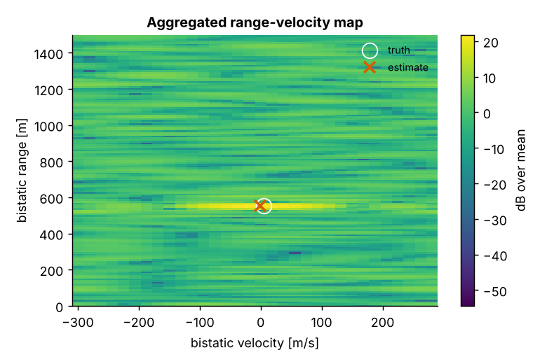
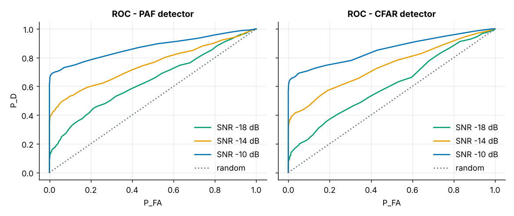
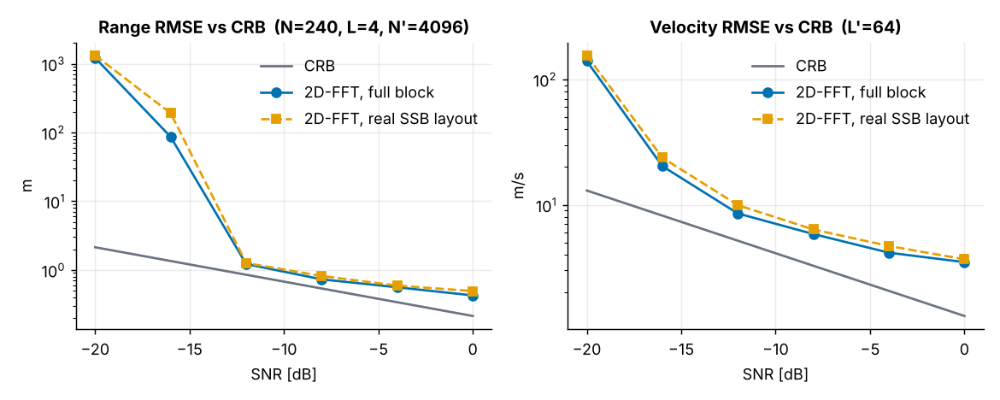
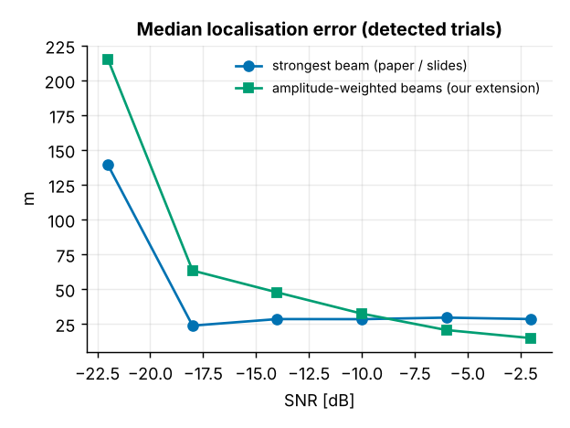
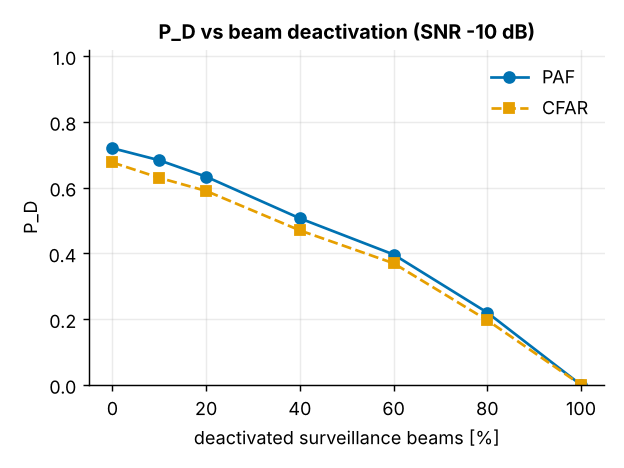
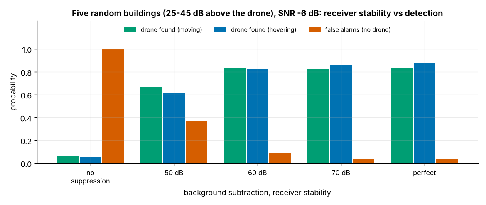

<div align="center">

# 📡 UAV Sensing in 5G-Advanced Networks
**Detect and localise drones using the 5G signals that are already in the air.**

An interactive Python simulator for passive bistatic radar in 5G-Advanced networks using Integrated Sensing and Communication (ISAC). Build custom 3D urban flight scenarios — complete with manoeuvring drones, static building clutter, and channel impairments — then run 2D FFT range-Doppler processing, benchmark CA-CFAR against the reference PAF detector, and localise targets in 3D space.

[](https://www.python.org/)
[](https://numpy.org/)
[](https://scipy.org/)
[](https://matplotlib.org/)
[](https://streamlit.io/)

*B.Tech Major Project · Group 37 · Dept. of ECE, MANIT Bhopal · Supervised by Dr. Rahul Pal*

</div>

---

## What it does

Integrated Sensing and Communication (ISAC) lets a cellular network *see* as well as talk. This simulator models a **passive bistatic radar** formed by two 5G base stations (**BsA** transmitting standard 5G NR Synchronization Signal Blocks, **BsB** passively listening to reflections) across two main interfaces:

**🛠️ Scenario Builder (Interface 1)**
Drop a drone into a 3D coordinate space manually or hit **New random try** to generate a stochastic flight path. Choose between straight-line flight or a multi-frame manoeuvring path (turns, climbs, speed changes), spawn random static buildings, and dial in SNR via a physical link budget or manual override before passing the state to the detector.

**📊 Detection Dashboard (Interface 2)**
Synthesize the 5G SSB baseband echoes for your saved scenario, compute per-beam and aggregated 2D range-velocity heatmaps, and run **PAF** (from the IEEE SPAWC 2025 paper) alongside **CA-CFAR** (our extension). Strip out static building clutter via reference background subtraction, intersect the transmit beam ray with the bistatic range ellipse for 3D localisation, or run thousand-trial Monte Carlo sweeps against the Cramér-Rao Bound (CRB).

---

## Key features

### Scenario Builder
- Manual or one-click random 3D UAV placement ($y \in [150, 500]\text{ m}$, altitude $z \in [20, 100]\text{ m}$) with configurable airspeed and heading
- Two kinematic modes: constant-velocity straight line or **random manoeuvring trajectory** with boundary reflections
- **Procedural urban buildings** redrawn on every run as zero-Doppler static reflectors with randomised Radar Cross Sections (RCS)
- Physical **radar link budget** calculator (Tx power, target RCS, bistatic path loss) alongside direct SNR input
- Toggleable channel non-idealities: **Swerling-1 target fading**, random SSB beam deactivation, uncancelled direct-path interference, and range-localised clutter
- Live top-down, elevation, and ground-truth bistatic range-velocity plots

### Detection Dashboard
- Real 3GPP **5G NR SSB resource mask** ($240\text{ subcarriers} \times 4\text{ OFDM symbols}$ at $60\text{ kHz}$ spacing, $15\text{ GHz}$ carrier, 830/960 active resource elements across PSS, SSS, and PBCH)
- Side-by-side **PAF** and **2D CA-CFAR** detection calibrated on 1,500 noise-only runs for a strict false-alarm rate ($P_{\text{FA}} = 0.03$)
- **Background subtraction** using a drone-free reference scan to cancel static buildings — enabling detection of hovering (zero-Doppler) drones
- **3D Ray × Ellipse localisation** comparing estimated range, bistatic velocity, beam angle, and $(x, y, z)$ coordinates against ground truth
- **Monte Carlo engine** + **Validation Viewer** for ROC curves, $P_D$ vs. SNR, beam deactivation sweeps, and RMSE vs. closed-form CRB

---

## Architecture

```text
┌──────────────────────────────┐         ┌──────────────────────────────┐
│   Interface 1: Scenario UI   │         │  Interface 2: Detection UI   │
│                              │  state  │                              │
│  3D UAV Kinematics · Urban   │ ──────► │  Range-Doppler Heatmaps ·    │
│  Buildings · Link Budget SNR │         │  PAF vs CFAR · 3D Localiser  │
└──────────────┬───────────────┘         └──────────────▲───────────────┘
               │                                        │
               │ Scenario & Config                      │ Detections, CRB & Plots
               ▼                                        │
┌──────────────────────────────┐         ┌──────────────┴───────────────┐
│   Channel & Array Engine     │         │    DSP & Estimation Core     │
│                              │  Z[n,l] │                              │
│  10×10 UPA (45 active beams) │ ──────► │  512×32 2D FFT · Background  │
│  3GPP SSB Mask · Swerling-1  │  echoes │  Subtraction · Ray ∩ Ellipse │
└──────────────────────────────┘         └──────────────▲───────────────┘
                                                        │
                                         ┌──────────────┴───────────────┐
                                         │   Monte Carlo & Validation   │
                                         │                              │
                                         │  Noise-Only P_FA Calibration │
                                         │  ROC · RMSE Sweeps · FIM CRB │
                                         └──────────────────────────────┘
```

The simulation follows a strict one-way data flow (`config` → `array` → `channel` → `processing` → `crb` → `montecarlo` → `scene` → `app`). Interface 1 writes a dataclass `Scenario` into Streamlit's `session_state`; Interface 2 reads that state, generates the complex baseband tensor across all $R = 45$ upward-looking surveillance beams, applies 2D IFFT/FFT processing, and evaluates detection and 3D position accuracy.

---

## Validation results

All benchmark plots are generated by `experiments/run_validation.py` and saved in [`outputs/`](outputs/).

| Range-velocity map | ROC (PAF vs CFAR) |
|:--:|:--:|
|  |  |

| RMSE vs CRB | Localisation error |
|:--:|:--:|
|  |  |

| $P_D$ vs beam deactivation | Buildings & clutter suppression |
|:--:|:--:|
|  |  |

---

## Tech stack

| Layer | Tech |
|---|---|
| Language | Python 3.12+ |
| Signal model & linear algebra | [NumPy](https://numpy.org/) — complex baseband tensors, 2D `fft` / `ifft`, Fisher Information Matrix inversion |
| Filtering & CFAR | [SciPy](https://scipy.org/) — `convolve1d` sliding windows for CA-CFAR, `signal.windows` |
| Visualization | [Matplotlib](https://matplotlib.org/) (`Agg` backend for headless figure rendering) |
| Frontend UI | [Streamlit](https://streamlit.io/) — multi-page state management via `session_state` |
| Data modelling | Python `dataclasses` (`SystemConfig`, `Scenario`, `ProcConfig`, `Building`, `Path`) |
| Testing | Standard `assert` suite + Streamlit `AppTest` for headless UI verification |

---

## Project structure

```text
uav5g-isac-sensing/
├── app.py                      # Streamlit frontend: Interface 1, Interface 2, Validation Viewer
├── requirements.txt            # numpy, scipy, matplotlib, streamlit
├── uav5g/                      # Core simulation & DSP package
│   ├── config.py               # SystemConfig (Table I), Scenario, ProcConfig, Building
│   ├── array.py                # 10×10 UPA steering vectors, 81-beam codebook, 45 surveillance beams
│   ├── channel.py              # Bistatic geometry, link budget, 3GPP SSB mask, echo synthesis
│   ├── processing.py           # 2D FFT, PAF, CA-CFAR, beam aggregation, 3D localisation
│   ├── crb.py                  # Closed-form range/velocity Cramér-Rao Lower Bounds
│   ├── montecarlo.py           # Random scenarios, ROC, RMSE sweeps, P_FA calibration
│   └── scene.py                # Manoeuvring flight paths, random buildings, multi-frame scoring
├── experiments/
│   └── run_validation.py       # Batch runner reproducing all validation figures -> outputs/
├── tests/
│   └── test_core.py            # 15 unit & headless UI tests
└── outputs/                    # Saved PNG plots, results.json, calibration.json, validation_log.txt
```

---

## Getting started

### Prerequisites
- Python 3.12+ (all dependencies install cleanly from PyPI; no external API keys or hardware required)

### 1. Clone & install

```bash
git clone [https://github.com/abhiramkonjeti-sudo/uav5g-isac-sensing.git](https://github.com/abhiramkonjeti-sudo/uav5g-isac-sensing.git)
cd uav5g-isac-sensing
python -m venv .venv
.venv\Scripts\activate          # Windows (macOS/Linux: source .venv/bin/activate)
pip install -r requirements.txt
```

### 2. Run the app

```bash
streamlit run app.py
```

Open **http://localhost:8501**. Start in **Interface 1** to build or randomise a drone scenario, then switch to **Interface 2** to run detection and localisation.

### 3. Run tests & regenerate validation figures (optional)

```bash
python tests/test_core.py                     # 15 unit + headless UI tests
python experiments/run_validation.py --quick  # ~2 min smoke test
python experiments/run_validation.py          # full validation suite -> outputs/ (~15 min)
```

---

## How the signal chain & detectors actually work

Each SSB burst spans 240 subcarriers across 4 OFDM symbols ($B = 14.4\text{ MHz}$). For each of the 45 upward surveillance beams at **BsA**, the passive receiver **BsB** forms a 2D periodogram via a 512-point IFFT across subcarriers (range) and a 32-point FFT across symbols (Doppler). Because an SSB block is only 4 symbols long, physical velocity resolution is coarse ($\Delta v = 150\text{ m/s}$ vs. range resolution $\Delta R \approx 20.8\text{ m}$), which causes the characteristic vertical streak on the range-velocity map; zero-padding to $512 \times 32$ interpolates the peak without changing the underlying resolution limit.

For detection, the paper's **PAF (Peak-to-Average-Floor)** metric compares the maximum amplitude peak against the mean of the map, while our **CA-CFAR** detector slides a guard-and-training window across range cells to adapt to local clutter. Both thresholds are calibrated empirically across 1,500 noise-only trials for $P_{\text{FA}} = 0.03$ ($\gamma_{\text{PAF}} \approx 4.54$, $\alpha_{\text{CFAR}} \approx 18.5$).

## How 3D localisation & clutter cancellation work

A bistatic range measurement $d = d_{\text{tx}} + d_{\text{rx}}$ defines a 3D ellipsoid with foci at **BsA** $(0,0,0)$ and **BsB** $(200,0,0)$. Since **BsA** sweeps directional transmit beams using a $10 \times 10$ Uniform Planar Array, the beam with the strongest echo gives a unit direction ray $\mathbf{u}$. Intersecting that ray with the bistatic ellipsoid yields a closed-form transmit distance:

$$d_{\text{tx}} = \frac{d^2 - L_b^2}{2(d - \mathbf{u} \cdot \mathbf{b})}, \quad \hat{\mathbf{p}}_{\text{drone}} = \mathbf{p}_A + d_{\text{tx}}\mathbf{u}$$

When static urban buildings are present, their strong zero-Doppler reflections can swamp a hovering or slow-moving drone. Enabling **Background Subtraction** subtracts a target-free reference scan from the live frame—bounded by a realistic receiver phase-stability floor—cleanly removing static building peaks while preserving the drone echo.

---

## Roadmap

- [ ] Validate against real over-the-air (OTA) 5G NR SSB captures from SDR hardware
- [ ] Add multi-frame Kalman filtering (EKF) to track trajectories across sequential bursts
- [ ] Extend building models to 3D ray-traced shadowing and multipath
- [ ] Multi-drone detection and data association
- [ ] Model moving ground clutter (vehicles, wind-blown trees) alongside static buildings

---

## Reference & team

Based on **N. Jopanya & J. Osorio**, *"Utilizing 5G NR SSB Blocks for Passive Detection and Localization of Low-Altitude Drones,"* IEEE SPAWC 2025.

Built by **Project Group 37** (Dept. of Electronics and Communication Engineering, MANIT Bhopal) under the supervision of **Dr. Rahul Pal**. Maintained by [Abhiram Konjeti](https://github.com/abhiramkonjeti-sudo).
